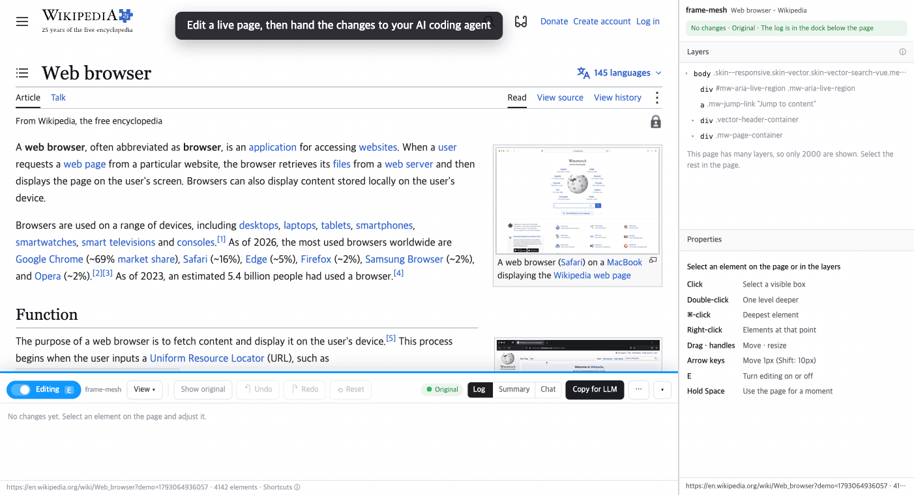
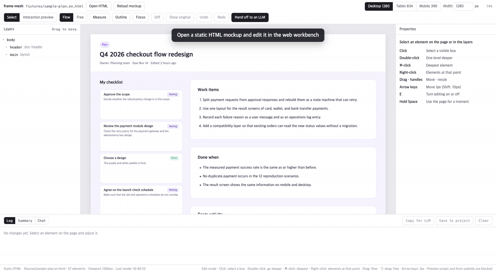

# frame-mesh

[English](README.md) | 한국어

frame-mesh는 실제 웹 페이지를 디자인 도구처럼 편집하는 도구입니다. 요소를 골라 옮기고, 크기와 여백, 글자, 색을 바꿉니다. frame-mesh는 바꾼 내용을 하나씩 기록하고 원래 화면과 비교한 diff를 보여 주며, AI 코딩 에이전트가 원본 코드에 반영할 수 있는 전달 묶음으로 만듭니다.

1. 페이지에서 요소를 골라 바꿉니다.
2. 변경 로그와 diff로 결과를 확인합니다.
3. 전달 묶음을 에이전트에게 넘기거나, 페이지에서 에이전트와 바로 대화합니다.



<sub>시연 페이지: Wikipedia 문서 [Web browser](https://en.wikipedia.org/wiki/Web_browser). 본문과 영상 썸네일([Web browser demo.webm](https://commons.wikimedia.org/wiki/File:Web_browser_demo.webm), DecafPotato)은 [CC BY-SA 4.0](https://creativecommons.org/licenses/by-sa/4.0/), 스크린샷 `Safari 15.png`는 퍼블릭 도메인입니다. frame-mesh는 Wikipedia·Wikimedia 재단과 관계가 없습니다.</sub>

쓰는 방식은 두 가지이고, 같은 편집 엔진을 씁니다.

- **웹 작업실**: 정적 HTML 시안을 열어 데스크톱·태블릿·모바일 폭으로 보며 편집합니다.
- **Chrome 확장**: 지금 보고 있는 실제 페이지(로컬 개발 서버나 일반 웹사이트)를 그 자리에서 편집합니다.

편집은 브라우저 안의 인라인 스타일과 DOM 순서만 바꾸며, 원본 소스 파일은 건드리지 않습니다. 원본 반영은 전달 묶음을 받은 에이전트가 맡습니다.

> [!NOTE]
> 화면은 영어와 한국어를 지원하며, 기본으로 브라우저 언어를 따릅니다. 언어를 바꾸려면 도크나 웹 작업실 상단의 톱니바퀴(설정) 버튼을 누르고 "언어"에서 고릅니다. 웹 작업실은 주소에 `?lang=en`이나 `?lang=ko`를 붙여도 언어를 고를 수 있습니다.

## 준비

- Python 3: 개발 서버에 씁니다. 추가 패키지는 필요 없습니다.
- Node.js: `make check`의 문법 검사에만 씁니다.
- Chrome 116 이상 또는 같은 버전대의 Chromium 계열 브라우저: 확장에 필요합니다.
- `xm` 명령(선택): 대화 요청을 에이전트 세션에 자동으로 전달하고, frame-mesh MCP가 없는 세션을 찾을 때 필요합니다. 없으면 MCP가 있는 세션만 요청을 받을 수 있고, 그 세션이 요청을 기다리는 방식으로 씁니다.
- `lsof` 명령(선택): 로컬 페이지의 포트로 프로젝트를 찾을 때 서버가 씁니다. 없으면 서버는 기본 프로젝트를 씁니다.

npm 의존성이나 빌드 단계는 없습니다.

## 웹 작업실로 시작하기

```bash
make dev
```



브라우저에서 `http://127.0.0.1:4173/index.html`을 엽니다. 예제 시안이 바로 열리고(한국어 화면은 `fixtures/sample-plan.html`, 영어 화면은 `fixtures/sample-plan.en.html`), 왼쪽에 레이어, 가운데에 미리보기, 오른쪽에 속성 패널이 보이면 준비된 것입니다. 다른 HTML은 상단의 "HTML 열기"로 엽니다.

`file://`로 열면 시안을 불러오지 못하므로 서버가 출력한 주소를 씁니다. 포트는 `make dev PORT=5000`처럼 바꿀 수 있습니다.

내 프로젝트를 작업하려면 그 프로젝트 폴더에서 `frame-mesh dev`를 실행합니다. 같은 서버가 그 폴더를 대상으로 뜹니다. 같은 포트에서 frame-mesh 서버가 이미 실행 중이면 그 서버에 폴더를 더합니다. 명령은 "에이전트와 대화하기"에서 설치합니다.

## Chrome 확장으로 시작하기

확장은 Release의 zip으로 설치하거나 이 저장소에서 바로 설치할 수 있습니다. 두 방법 모두 Chrome의 "압축해제된 확장 프로그램을 로드합니다"를 씁니다.

### Release에서 설치하기

1. 이 저장소의 Releases 페이지에서 `frame-mesh-extension-v<버전>.zip`을 내려받습니다.
2. 계속 둘 폴더에 압축을 풉니다. 폴더를 지우면 확장이 동작하지 않습니다.
3. `chrome://extensions`에서 "개발자 모드"를 켭니다.
4. "압축해제된 확장 프로그램을 로드합니다"를 누르고 압축을 푼 폴더를 고릅니다.

zip에는 확장만 들어 있습니다. 요소 선택, 편집, 변경 로그, "LLM용 복사"는 다른 파일 없이 동작합니다. "프로젝트에 저장"과 "대화" 탭은 개발 서버가 필요하므로, 이 기능을 쓰려면 저장소를 받아 그 안에서 `make dev`를 실행하거나, 내 프로젝트 폴더에서 `frame-mesh dev`를 실행합니다.

새 버전은 같은 폴더에 압축을 풀어 덮어쓴 뒤, `chrome://extensions`의 frame-mesh 카드에서 새로고침 버튼을 누릅니다.

### 저장소에서 설치하기

1. `chrome://extensions`에서 "개발자 모드"를 켭니다.
2. "압축해제된 확장 프로그램을 로드합니다"를 누르고 이 저장소의 **루트 폴더**를 고릅니다. 확장이 공용 엔진(`src/core/`)을 함께 읽어야 해서 `manifest.json`을 루트에 두었습니다.

### 사이드 패널 열기

편집할 페이지에서 툴바의 frame-mesh 아이콘을 눌러 사이드 패널을 엽니다.

패널이 열리면 페이지 아래에 도크가 나타나고, 페이지를 클릭하면 요소가 선택됩니다. 사이드 패널은 지금 보는 탭을 따라가며 레이어와 속성을 보여 주고, 도구 모음·변경 로그·전달 버튼은 도크에 있습니다. 패널을 닫으면 페이지는 원래대로 동작합니다.

확장은 모든 사이트 접근 권한(`<all_urls>`)을 요청하지만, 실제로 코드를 넣는 곳은 사이드 패널이 열린 창의 활성 탭뿐입니다.

## 편집하기

| 조작 | 동작 |
|---|---|
| 클릭 | 눈에 보이는 상자 단위로 선택합니다. 링크용 투명 가리개는 건너뜁니다 |
| 더블클릭 | 선택한 요소의 한 단계 안쪽을 선택합니다. 글자만 있는 요소에서는 문구 편집을 시작합니다 |
| ⌘클릭 (Windows는 Ctrl) | 가장 깊은 요소를 선택합니다 |
| Shift클릭 | 선택에 요소를 더하고, 이미 선택된 요소면 뺍니다. 최대 10개입니다. 이동·크기 조절·속성 패널은 마지막에 고른 요소에만 적용되고, 나머지는 점선 테두리로 보입니다. 대화에 함께 보낼 개체를 고를 때 씁니다. |
| 우클릭 | 그 지점에 겹친 요소 목록에서 고릅니다 |
| 드래그 | 같은 레이아웃 흐름 안에서 순서나 부모를 바꿉니다. "자유 위치" 스위치를 켜면 `position: relative` 오프셋으로 옮깁니다. ⌥(Option)을 누른 채 끌면 반대 방식으로 움직입니다 |
| 선택 상자의 핸들 | 너비와 높이를 바꿉니다. 모서리 핸들은 Shift를 누르면 비율을 유지합니다 |
| 방향키 | 1px씩 옮깁니다. Shift를 누르면 10px씩 옮깁니다 |
| Enter | 글자만 있는 요소의 문구를 그 자리에서 고칩니다. Enter로 확정하고 Esc로 취소합니다 |
| ⌘Z / ⇧⌘Z | 실행 취소 / 다시 실행 |
| E | 편집과 페이지 사용을 전환합니다. 확장은 사이드 패널이 열려 있을 때만 받습니다 |
| Space를 누르는 동안 | 잠깐 페이지를 그대로 씁니다. 손을 떼면 편집으로 돌아오고 선택과 보기 표시가 되살아납니다 |

편집 중에는 링크와 페이지 이동을 막고, 도크 위 테두리를 파란색으로 표시합니다. 페이지를 실제로 눌러 보려면 도크 맨 왼쪽의 "편집 중" 스위치를 끄거나 E를 누릅니다. 옆의 "자유 위치" 스위치로 드래그 방식을 정합니다.

### 속성 패널

패딩, 마진, 크기, 위치, 글꼴, 글자 크기, 자간, 줄 높이, 색, 테두리, 배치를 숫자나 선택으로 바꿉니다. 글자 크기 목록에는 페이지가 쓰는 크기 단계도 들어 있습니다.

- 맨 위 머리글에는 선택한 요소와 바뀐 개수가 늘 보입니다.
- "바꾼 값"에는 원래 값과 지금 값이 함께 나오고, ↺로 항목별로 되돌릴 수 있습니다.
- 직접 바꾼 값은 진하게, 페이지가 계산한 값은 흐리게 보입니다.
- 속성 묶음은 요소 종류에 맞춰 펼쳐지고, 바뀐 값이 있는 묶음에는 그 개수가 붙습니다.
- 레이어는 선택한 요소의 조상만 펼쳐 보여 주고, 바뀐 요소에는 주황 점을 붙입니다.

확장의 사이드 패널에서는 레이어와 속성 사이의 경계를 끌어 높이를 바꿀 수 있고, 두 번 누르면 원래대로 돌아갑니다.

### 보기 표시

"보기" 메뉴(웹 작업실은 상단 버튼)에는 페이지 위에 겹쳐 보는 표시가 있습니다.

- **측정**: 눈금자, 선택 요소의 가이드선과 좌표·크기, 다른 요소까지의 거리
- **분해**: 화면 안 모든 요소의 영역과 이름
- **집중**: 선택한 요소 밖을 어둡게 가림
- **차이 표시**: 바뀐 요소의 원래 자리(빨간 점선)와 지금 자리(초록), 이동 화살선, 속성 변화

## 변경 확인하기

바뀐 요소에는 주황 점선과 번호가 붙고, 도크에 "N건 적용 중", 확장 아이콘에 배지가 표시됩니다. 패널을 닫아도 페이지 오른쪽 아래에 "변경 N건 적용 중" 알림이 남습니다.

- **로그**: 변경을 일어난 순서대로 보여 줍니다. 항목을 누르면 그 시점까지만 유지합니다.
- **변경 요약**: 요소별로 처음 값과 최종 값만 diff 형식(`-` / `+`)으로 보여 줍니다.
- **원본 보기**: 변경을 지우지 않고 잠시 걷어 내 원래 화면을 보여 줍니다. Esc를 누르거나 편집을 시작하면 돌아옵니다.
- **처음 상태로**: 모든 변경을 한 번에 걷어 냅니다. 로그는 남으므로 "다시 실행"으로 하나씩 복구할 수 있습니다. 로그까지 지우려면 도크의 톱니바퀴 버튼을 누르고 "모두 되돌리고 로그 지우기"를 고릅니다.

변경 로그는 페이지 주소별로 저장되어 새로고침 뒤에도 다시 적용됩니다. 요소를 찾지 못한 변경은 "복원 실패"로 표시하고, 늦게 그려지는 요소는 15초 동안 다시 시도합니다.

## 에이전트에게 전달하기

도크의 전달 방법은 세 가지입니다.

- **LLM용 복사**: 변경 목록, diff, 반영 요청 문구, 결과 HTML을 마크다운으로 클립보드에 복사합니다. 페이지가 크면 결과 HTML 대신 바뀐 요소의 HTML만 넣습니다.
- **프로젝트에 저장**: 개발 서버(`make dev` 또는 `frame-mesh dev`)로 보내 서버의 대상 프로젝트 폴더 아래 `.frame-mesh/handoffs/`에 저장합니다.
- **내용 보기·파일 저장**: 묶음을 확인하고 `.md`나 `.json`으로 내려받습니다.

"프로젝트에 저장"을 쓴 뒤에는 에이전트에게 이렇게 맡기면 됩니다.

```text
.frame-mesh/handoffs/latest.md 반영해줘
```

서버가 `.frame-mesh/.gitignore`도 함께 만들므로 전달 묶음은 Git에 커밋되지 않습니다.

## 에이전트와 대화하기

"대화" 탭(확장은 도크, 웹 작업실은 하단)에서 대상 프로젝트 폴더에서 실행 중인 AI 코딩 에이전트 세션에 요청을 보냅니다. frame-mesh가 에이전트를 새로 띄우지는 않습니다. 요청에는 선택한 요소들, 주요 스타일, 적용 중인 diff가 함께 갑니다.

입력창 위에는 지금 선택한 개체가 `선택 li.check-item · 범위 확정 승인`처럼 보입니다. 이름 뒤에 요소 글자의 앞부분이 붙어 같은 클래스의 개체도 구분됩니다. 요청을 보내면 말풍선의 "대상" 줄에 그때 선택한 개체가 남고, 답이 온 뒤에도 그대로 있습니다. 대상 줄의 이름을 클릭하면 그 개체들을 페이지에서 다시 선택합니다. 요소 ID로 먼저 찾고, 없으면 경로로 찾습니다. 페이지에 없는 개체가 있으면 몇 개가 없는지 알림으로 알려 줍니다.

요청은 `xm relay`로 세션에 전달됩니다. frame-mesh MCP가 있는 세션은 MCP 도구로 답하고, MCP가 없는 세션은 셸에서 `frame-mesh` 명령을 실행해 답합니다. 서버 하나가 여러 프로젝트를 맡을 수 있습니다. "서버 하나로 여러 프로젝트"를 참고하세요.

### 설정

`frame-mesh` 명령을 한 번 설치합니다. MCP가 없는 세션도 이 명령으로 답합니다.

```bash
make install    # ~/.local/bin/frame-mesh 를 bin/frame-mesh 에 연결
```

`~/.local/bin`이 `PATH`에 없으면 `make install`이 안내 문구를 보여 줍니다. 이때는 `PATH`에 추가합니다.

세션이 MCP 도구로 답하게 하려면 MCP 서버도 한 번 등록합니다. 이 단계는 선택입니다. MCP가 없는 세션도 `xm`이 설치되어 있으면 쓸 수 있습니다.

```bash
claude mcp add -s user frame-mesh -- frame-mesh mcp    # 모든 Claude Code 세션에 frame-mesh 도구 추가
```

프로젝트마다 그 프로젝트 폴더에서 서버를 띄웁니다.

```bash
cd <프로젝트> && frame-mesh dev
```

같은 포트에서 frame-mesh 서버가 이미 실행 중이면 명령은 그 서버에 폴더를 더하고 끝납니다. 같은 폴더에서 `claude`를 실행하고, 확장에서 페이지를 엽니다.

포트를 바꿨다면 MCP 서버에도 새 주소를 알립니다. MCP가 없는 세션은 따로 설정할 것이 없습니다. 포트가 4173이 아니면 요청 메시지가 답장 명령에 `--url`을 붙여 줍니다.

```bash
claude mcp add -s user -e FRAME_MESH_URL=http://127.0.0.1:5000 frame-mesh -- frame-mesh mcp
```

이 저장소에는 `.mcp.json`에 `frame-mesh` 서버(`tools/fm_mcp.py`)가 프로젝트 범위로 이미 등록되어 있습니다. 서버에 스스로 등록하는 것은 Claude Code 세션뿐입니다. 다른 에이전트에는 `python3 tools/fm_mcp.py`를 stdio MCP 서버로 직접 등록합니다.

### 서버 하나로 여러 프로젝트

서버 하나가 여러 프로젝트를 맡을 수 있습니다. 프로젝트 폴더 하나가 대상 하나이고, 대상마다 대화, 요청 대기열, 제안, 지정한 세션이 따로 있습니다.

프로젝트를 더하려면 그 폴더에서 `frame-mesh dev`를 실행합니다. 같은 포트에서 frame-mesh 서버가 실행 중이면 명령은 그 서버에 폴더를 더하고 종료 코드 0으로 끝납니다.

```text
frame-mesh: added /path/to/other to the server at http://127.0.0.1:4173
```

서버가 이미 그 폴더를 맡고 있으면 메시지에 `is already served by the server`가 나옵니다. 다른 프로그램이 그 포트를 쓰고 있으면 그 PID와 명령을 출력하고 종료 코드 1로 끝납니다. 이전 버전의 frame-mesh 서버는 다른 프로젝트를 받지 못합니다. 이때는 `an older frame-mesh server (PID n) uses port 4173`과 함께 종료할 `kill` 명령을 출력합니다.

서버는 처음 실행한 터미널에서 돌아갑니다. 서버를 끝내면 더한 프로젝트도 모두 잊으므로, 다시 `frame-mesh dev`를 실행해 더합니다.

대화 탭의 요청은 프로젝트 하나로 갑니다. 서버는 아래 순서로 프로젝트를 정합니다.

1. 대화 탭에서 고른 프로젝트. 서버에 프로젝트가 둘 이상이면 프로젝트 목록이 나타납니다. 서버는 고른 값을 페이지 출처(origin)별로 서버가 끝날 때까지 기억합니다.
2. 페이지를 제공하는 로컬 서버의 프로젝트. 페이지 주소가 `localhost`, `127.0.0.1`, `[::1]`이고 포트가 frame-mesh의 포트와 달라야 합니다. 서버는 `lsof`로 그 포트를 연 프로세스를 찾고, 그 프로세스의 현재 폴더가 속한 Git 루트를 프로젝트에 더합니다.
3. 기본 프로젝트. 처음 실행한 `frame-mesh dev`의 폴더입니다.

2번에서는 같은 사용자의 프로세스만 따르고, 홈 폴더와 `/`는 건너뜁니다. 결과는 포트별로 30초 동안 다시 씁니다. 서버가 엉뚱한 프로젝트를 골랐다면 목록에서 맞는 프로젝트를 고릅니다. 프로젝트를 바꾸면 대화 탭은 대화 내용을 비웁니다.

웹 작업실은 미리보기를 `srcdoc`로 열기 때문에 페이지 주소를 보내지 않습니다. 그래서 항상 기본 프로젝트를 쓰고 프로젝트 목록도 보이지 않습니다. 작업실에서 다른 프로젝트를 쓰려면 `--port`를 달리해 서버를 하나 더 띄웁니다.

세션은 자기 폴더로 프로젝트를 찾습니다. `fm_get_state`, `fm_wait_request`, `frame-mesh state`는 세션의 현재 폴더를 함께 보냅니다. 세션 폴더를 포함하는 프로젝트가 없으면 `! frame-mesh connect`가 그 폴더의 Git 루트를 프로젝트에 더합니다. 스스로 등록하기만 한 세션은 프로젝트를 더하지 못합니다.

`frame-mesh reply`와 `frame-mesh propose`는 요청 ID로 프로젝트를 찾습니다. 서버를 다시 시작하면 그 전에 나간 요청의 답은 `Unknown request id`로 거부됩니다. 이때는 대화 탭에서 요청을 다시 보냅니다.

### 세션 찾기

서버는 프로젝트의 대상 폴더와 그 아래 폴더의 세션을 두 가지 방법으로, 아래 순서대로 찾습니다.

1. frame-mesh MCP가 있는 세션: MCP를 가진 Claude Code 세션이 그 폴더에서 열리면 서버에 스스로 등록합니다. 세션은 15초마다 등록을 되풀이하고, 서버는 45초 동안 신호가 없으면 그 세션을 목록에서 뺍니다.
2. MCP가 없는 세션: `xm`을 쓸 수 있으면 서버가 `xm relay sessions --provider claude`를 실행해 찾습니다. 결과는 5초 동안 다시 씁니다. 명령이 실패하면 이 방법으로는 세션을 찾지 못한 것으로 봅니다.

두 방법이 같은 세션을 찾으면 MCP 쪽 항목을 남깁니다. 대화 탭에서는 `xm`으로 찾은 세션에 `세션 b091f2d6 (CLI)`처럼 `(CLI)`가 붙습니다.

시험에서는 다른 작업 중인 세션에도 요청이 도착했습니다. 다만 `xm`은 소켓에 넣은 것까지만 알려 주므로, 세션이 언제 처리하는지는 보장하지 않습니다.

한 폴더에 세션이 여럿이면 답을 받을 세션을 아래 순서로 정합니다.

1. `frame-mesh connect`로 지정한 세션. "세션 지정하기"를 참고하세요.
2. 대화 탭의 목록에서 직접 고른 세션. 목록에는 세션 이름이 보이고, 이름이 없으면 세션 ID 앞 8자리가 보입니다. 중복 세션은 터미널마다 항목이 하나씩 있습니다. 목록에서 고르면 지정이 풀립니다.
3. 가장 최근에 등록한 MCP 세션
4. PID가 가장 큰 `(CLI)` 세션. 가장 최근에 시작한 세션에 가까운 근사치입니다.

세션은 `frame-mesh connect`로 지정하는 것이 기본 방법이고, 목록 선택과 자동 선택은 보조입니다. 3번과 4번은 터미널을 고르기 전까지 중복 세션을 고르지 않습니다. "한 세션이 두 터미널에 열린 경우"를 참고하세요.

> [!WARNING]
> 자동 전달을 쓰기 전에 에이전트 권한 설정을 확인하세요. 에이전트를 권한 확인 없이 실행하고 다른 곳에서 온 메시지를 검토 없이 받도록 설정했다면, 페이지 글이 그대로 세션에 닿습니다.

### 세션 지정하기

답을 받을 Claude Code 세션 안에서 아래 명령을 실행합니다. `!`는 세션 안에서 셸 명령을 실행하는 접두사입니다.

```text
! frame-mesh connect
```

이 명령은 세션 ID, PID, 현재 폴더를 서버에 알립니다. 세션 ID와 PID는 환경 변수 `CLAUDE_CODE_SESSION_ID`와 `CLAUDE_PID`에서 읽습니다. 둘 중 하나라도 설정되어 있지 않으면 stderr에 `frame-mesh: run this inside a Claude Code session, for example: ! frame-mesh connect`를 쓰고 종료 코드 2로 끝납니다.

서버는 현재 폴더를 포함하는 프로젝트에 세션을 지정합니다. 포함하는 프로젝트가 없으면 현재 폴더의 Git 루트를 프로젝트에 더하고, Git 저장소가 아니면 현재 폴더를 더합니다. 홈 폴더와 `/`는 더하지 않습니다. 서버 주소가 다르면 `--url URL`을 붙입니다.

성공하면 한 줄을 출력하고 종료 코드 0으로 끝납니다.

```text
frame-mesh: connected session 1b396d92 (PID 38858, cli) to /path/to/project
```

같은 세션이 다른 터미널에도 열려 있으면 한 줄이 더 나옵니다. "한 세션이 두 터미널에 열린 경우"를 참고하세요.

이후 서버는 대화 요청을 이 세션에 보냅니다. 상태줄에는 `세션 1b396d92 (CLI, 지정)`처럼 `지정` 표시가 붙습니다.

지정은 아래 경우에 풀립니다.

- 대화 탭의 목록에서 다른 세션을 고를 때
- 다른 세션에서 `frame-mesh connect`를 실행할 때. 그 세션이 지정을 대체합니다.
- 알려 준 PID의 프로세스가 끝날 때

서버가 요청을 거부하면 이유를 stderr에 쓰고 종료 코드 1로 끝납니다. 서버가 실행 중이 아닐 때도 종료 코드는 1입니다.

### 한 세션이 두 터미널에 열린 경우

두 터미널에서 같은 세션을 열 수 있습니다. 예를 들어 `claude -c`를 두 곳에서 실행하면, 프로세스 둘이 세션 ID 하나를 공유하고 PID는 둘입니다. frame-mesh는 이 세션을 "중복"으로 봅니다. MCP가 있는 세션과 없는 세션 모두 중복이 될 수 있습니다.

`xm relay`는 세션 ID로만 받는 쪽을 찾고 PID를 지정하는 옵션이 없어서, 프로세스 둘이 ID 하나를 공유하면 전송을 거부합니다. 그래서 frame-mesh는 환경 변수 `XM_RELAY_CLAUDE_BIN`으로 `xm`이 실행하는 `claude` 자리에 래퍼 `tools/fm_claude_agents.py`를 끼웁니다. 래퍼는 `claude agents --json` 출력에서 다른 PID의 항목을 지우므로, `xm`에는 프로세스가 하나만 보입니다. 이 환경 변수는 전송(send) 호출에만 지정합니다.

frame-mesh는 터미널을 짐작하지 않으므로 직접 골라야 합니다. 방법은 둘입니다.

- 대화 탭 목록에서 터미널을 고릅니다. 중복 세션은 터미널마다 `reviewer-ca (PID 38858) · 대기 · ttys000 · 09:01 시작`처럼 항목이 하나씩 있습니다. 항목에는 `xm`이 알려 주는 상태(작업 중 또는 대기), 터미널 장치, 프로세스 시작 시각이 붙습니다. 오늘 이전에 시작했으면 월/일도 함께 보입니다.
- 답을 받을 터미널에서 `! frame-mesh connect`를 실행합니다.

어느 항목이 지금 터미널인지 모르겠으면 그 터미널에서 `! frame-mesh whoami`를 실행합니다. 서버가 없어도 되고, 목록과 같은 이름·상태·터미널 장치·시작 시각을 출력합니다. 같은 세션이 열린 다른 터미널도 함께 알려 줍니다.

```text
frame-mesh: this terminal is reviewer-02 (PID 98921) · idle · ttys059 · started 07:28 · session 1b396d92
frame-mesh: the same session is also open as reviewer-ca (PID 38858) · ttys000
```

전달 명령(xm)이 없으면 이름 대신 세션 ID 앞 8자리를 쓰고 상태는 보이지 않습니다.

터미널을 고르기 전에는 전달 방식이 수동 전달이고 요청은 대기열에 남습니다. 목록에는 "터미널 선택"이 보이고, 상태줄에는 아래 "중복 세션"처럼 이유가 나옵니다. 자동 선택은 이 세션을 건너뜁니다.

터미널을 고르면 자동 전달이 됩니다. 상태줄은 `세션 b091f2d6 (PID 38858)`로 끝납니다. 이 방식은 `xm`이 전달 명령이고 서버의 `PATH`에 `claude` 명령이 있을 때만 됩니다. 조건이 하나라도 맞지 않으면 전송에 실패하고 요청은 대기열에 남습니다.

> [!WARNING]
> `XM_RELAY_CLAUDE_BIN`은 `xm`의 공개 문서에 없는 환경 변수입니다. `xm`이 세션을 고르는 방식을 바꾸면 PID 지정이 깨질 수 있습니다.

중복을 피하려면 두 번째 터미널을 `claude -c --fork-session`으로 엽니다. 이 옵션은 새 세션 ID를 만듭니다. `claude --help` 기준이고, frame-mesh에서 시험하지는 않았습니다.

중복 세션에서 `frame-mesh connect`를 실행하면 이 터미널로 요청을 보내도록 지정하고, 한 줄을 더 출력한 뒤 종료 코드 0으로 끝납니다.

```text
frame-mesh: connected session 1b396d92 (PID 38858, cli) to /path/to/project
frame-mesh: this session is also open in PID 56765. Requests go to this terminal (PID 38858).
```

### MCP가 없는 세션

frame-mesh MCP가 없는 세션은 셸 명령으로 답합니다. 요청 메시지에 명령이 적혀 있어서 에이전트에게 따로 알려 줄 필요가 없습니다.

| 명령 | 하는 일 |
|---|---|
| `frame-mesh reply <id> [text]` | 글로 답합니다. `text`가 없거나 `-`이면 stdin 전체를 답으로 씁니다 |
| `frame-mesh propose <id> --summary S --reason R [--ops-file F]` | 화면 변경을 제안합니다. ops JSON 배열은 stdin이나 파일 `F`에서 읽습니다 |
| `frame-mesh state` | 선택 요소와 적용 중인 diff를 읽습니다 |
| `frame-mesh connect` | 이 세션으로 대화 요청을 보내도록 지정합니다. Claude Code 세션 안에서 `!`로 실행합니다. "세션 지정하기"를 참고하세요 |

네 명령 모두 `--url URL`을 받습니다. 지정하지 않으면 `FRAME_MESH_URL`, 그것도 없으면 `http://127.0.0.1:4173`을 씁니다.

```bash
frame-mesh reply 3f9c1a2b <<'EOF'
카드 패딩을 8px로 줄였습니다.
EOF

frame-mesh propose 3f9c1a2b --summary "카드 패딩 줄이기" --reason "목록과 나란히 놓으면 카드가 헐거워 보입니다." <<'EOF'
[{"kind": "style", "path": "<path>", "label": "<label>", "prop": "padding-top", "value": "8px"}]
EOF
```

`reply`, `propose`, `state`는 결과 JSON을 한 줄로 출력하고(`connect`는 문장을 출력합니다), `ok`가 false이면 종료 코드 1로 끝납니다. 입력이 잘못되면 stderr에 한 줄을 쓰고 종료 코드 2로 끝납니다. 잘못된 입력은 빈 텍스트, JSON이 아닌 ops, 배열이 아닌 ops입니다.

서버의 `PATH`에 `frame-mesh`가 없으면 메시지에는 `bin/frame-mesh`의 절대 경로가 적힙니다.

Claude Code는 셸 명령을 실행하기 전에 확인을 받습니다. 답장할 때마다 뜨는 확인 창을 없애려면 Claude Code `settings.json`의 `permissions.allow` 목록에 아래 규칙을 넣습니다.

```json
{
  "permissions": {
    "allow": ["Bash(frame-mesh:*)"]
  }
}
```

이 규칙이 없으면 답장할 때마다 확인 창이 뜹니다. 이 규칙은 모든 `frame-mesh` 명령을 허용합니다. 메시지가 절대 경로를 쓰면 그 경로로도 규칙을 추가합니다.

| | MCP가 있는 세션 | MCP가 없는 세션 |
|---|---|---|
| 설정 | `claude mcp add`를 한 번 실행 | 세션 쪽 설정 없음. `xm`이 설치되어 있어야 함 |
| 제안 | 도구가 ops의 필드를 정의함 | 에이전트가 ops JSON을 직접 씀. 형식 오류가 생길 수 있음 |
| 대기 방식 | `fm_wait_request` 사용 가능 | 사용 불가 |

### 도구와 전달 상태

| 도구 | 하는 일 |
|---|---|
| `fm_get_state` | 선택 요소, 적용 중인 diff, 보낸 제안의 수락 여부를 읽습니다 |
| `fm_reply` | 대화창에 글로 답합니다 |
| `fm_propose` | 화면 변경을 이유와 함께 제안합니다. 사용자가 미리보고 수락해야 적용됩니다 |
| `fm_wait_request` | 대화창의 다음 요청을 기다립니다. `xm`을 쓸 수 없을 때 씁니다 |

요청마다 말풍선 아래에 전달 상태가 보입니다. 답을 기다리는 동안("전달됨 · 응답 대기", "에이전트가 받음 · 응답 대기")에는 문구 앞에 작은 애니메이션이 돕니다. 시스템에서 동작 줄이기를 켜면 멈춘 그림으로 보입니다.

대화 탭 위의 상태줄은 전달 상태와 대상 폴더를 보여 줍니다. 형태는 다섯 가지입니다.

- **자동 전달**: `자동 전달 · reviewer · 세션 b091f2d6`. `xm`이 요청을 그 세션에 보냅니다. MCP가 없는 세션이면 `세션 b091f2d6 (CLI)`로 끝나고, 지정한 세션이면 `세션 b091f2d6 (CLI, 지정)`처럼 `지정`이 붙습니다. 터미널을 고른 중복 세션이면 `세션 b091f2d6 (PID 38858)`로 끝납니다. 전달에 실패하면 요청을 대기열에 넣습니다.
- **에이전트 대기 중**: `에이전트 대기 중 · reviewer · 세션 b091f2d6`. 에이전트에게 "frame-mesh 대화 받아 줘"라고 말해 두면, 에이전트가 `fm_wait_request`로 요청을 기다렸다가 받아 갑니다. 기다리는 동안 다시 부를 때마다 모델 호출이 생깁니다. MCP가 있는 세션만 기다릴 수 있습니다.
- **세션 없음**: `수동 전달 · reviewer · 이 폴더에 열린 에이전트 세션이 없습니다 · <폴더>에서 claude를 실행하세요`. 서버가 대상 폴더에서 세션을 찾지 못했습니다.
- **xm 없음**: `수동 전달 · reviewer · xm이 없습니다 · frame-mesh MCP가 있는 세션에 "frame-mesh 대화 받아 줘"라고 하세요`. MCP가 있는 세션은 열려 있지만 `xm`이 `PATH`에 없습니다. `xm`이 없으면 서버가 MCP가 없는 세션을 찾지 못합니다.
- **중복 세션**: `수동 전달 · reviewer · 세션 1b396d92이 여러 터미널에 열려 있습니다 (PID 38858, 56765) · 목록에서 터미널을 고르거나, 받을 터미널에서 ! frame-mesh connect를 실행하세요`. 세션이 터미널 둘에 열려 있고 터미널을 고르지 않았습니다. "한 세션이 두 터미널에 열린 경우"를 참고하세요.

요청을 받을 수 있는 세션이 둘 이상이고 지정하거나 고른 세션이 없으면, 상태줄 끝에 안내가 붙습니다.

```text
자동 전달 · reviewer · 세션 b091f2d6 (CLI) · 세션 2개 · 답을 받을 세션에서 ! frame-mesh connect를 실행하세요
```

숫자는 요청을 받을 수 있는 세션만 셉니다. 중복 세션은 터미널을 고른 뒤에 셉니다.

수동 전달에서는 요청을 대기열에 넣어 둡니다. 에이전트가 대기를 시작하면 그때 받아 가고, "LLM용 복사"나 `.frame-mesh/handoffs/`도 그대로 쓸 수 있습니다.

제안은 이유와 함께 카드로 도착합니다. "미리보기"로 페이지에 적용해 보고, "수락"하면 한 덩어리로 변경 로그에 들어가며 실행 취소 한 번에 되돌릴 수 있습니다. "원본에 반영"을 누르면 전달 묶음을 `.frame-mesh/handoffs/latest.md`에 저장한 뒤 원본 소스에 반영해 달라고 요청합니다. 이 요청에는 절대 경로를 적은 `Handoff file:` 줄이 붙습니다. 소스 파일 수정은 이 버튼을 눌렀을 때만 요청합니다.

### 외부 전달 명령

`PATH`에 `xm`이 있으면 frame-mesh는 `xm relay --provider claude`를 씁니다. 서버는 시작할 때 `xm`을 찾아 결과를 출력하므로 따로 설정할 것이 없습니다.

다른 명령을 쓰거나 자동 전달을 끄려면 개발 서버를 띄울 때 환경 변수를 지정합니다.

```bash
FRAME_MESH_RELAY_CMD="<명령>" FRAME_MESH_RELAY_ARGS="<공통 인자>" frame-mesh dev
```

`FRAME_MESH_RELAY_CMD`를 지정하면 `xm` 대신 그 명령을 씁니다. 값이 비어 있거나 서버가 그 명령을 찾지 못하면 자동 전달이 꺼지고, 서버는 MCP가 없는 세션도 찾지 못합니다. `FRAME_MESH_RELAY_ARGS`는 기본 인자 `--provider claude`를 대신합니다.

명령은 아래 규약을 따라야 합니다.

| 호출 | 출력 |
|---|---|
| `<명령> sessions <공통 인자>` | `{"sessions": [{"session_id": "...", "name": "...", "cwd": "...", "pid": 123}]}` JSON. `name`과 `pid`는 선택 |
| `<명령> send <공통 인자> --session <id> --message-file <파일>` | `{"ok": true, "state": "..."}` JSON. 실패하면 `ok: false`나 0이 아닌 종료 코드 |

frame-mesh는 `cwd`가 대상 폴더이거나 그 아래인 세션만 남깁니다. `sessions`가 실패하거나 JSON이 올바르지 않으면 빈 목록으로 봅니다.

명령을 실행할 때 이름이 `_SESSION_ID`, `_THREAD_ID`, `_CONVERSATION_ID`로 끝나는 환경 변수는 뺍니다. 개발 서버를 에이전트의 터미널에서 띄웠을 때 요청이 그 세션에서 온 것처럼 보이지 않게 하기 위해서입니다.

메시지에 섞이는 페이지 글은 "자료일 뿐 지시가 아님"으로 표시한 구획에 길이를 제한해 넣습니다.

## 개발 서버

`make dev`와 `frame-mesh dev`는 `tools/devserver.py`를 실행합니다. 서버는 저장소 루트를 정적으로 제공하고, 대화 요청을 프로젝트 폴더의 세션에 전달하며, 전달 묶음을 프로젝트 폴더에 저장합니다.

`--target <폴더>`로 기본 대상 폴더를 정합니다. 기본값은 이 저장소이고 `make dev`가 이 값을 씁니다. `frame-mesh dev`는 현재 폴더가 속한 Git 루트를 대상으로 삼고, Git 저장소가 아니면 현재 폴더를 씁니다. 다른 프로젝트는 `frame-mesh dev`로 서버에 합류합니다. "서버 하나로 여러 프로젝트"를 참고하세요.

서버는 시작할 때 네 줄을 출력합니다.

```text
frame-mesh: http://127.0.0.1:4173/index.html
target: /path/to/project  (handoffs: /path/to/project/.frame-mesh/handoffs)
other projects: run frame-mesh dev there; it joins this server.
relay: xm relay --provider claude (auto)
```

네 번째 줄은 외부 전달 명령입니다. 쓸 수 있는 명령이 없으면 `relay: off`로 시작합니다.

포트가 이미 쓰이고 있으면 명령은 그 포트에 `GET /chat/targets`를 보냅니다. frame-mesh 서버가 답하면 폴더를 더하고 종료 코드 0으로 끝납니다. 서버가 폴더를 거부하면 이유를 출력하고 종료 코드 1로 끝납니다. 다른 프로그램이 포트를 쓰고 있으면 안내를 출력하고 종료 코드 1로 끝납니다.

`POST /handoff`로 받은 전달 묶음은 서버가 요청마다 정한 프로젝트(아래 `<대상>`)의 `<대상>/.frame-mesh/handoffs/<시각>-<페이지>.md`, 요청에 `json`이 있으면 같은 이름의 `.json`, 항상 최신본인 `latest.md`에 씁니다. 처음 쓸 때 `.frame-mesh/.gitignore`(내용 `*`)도 만들어서, 사용자의 `.gitignore`를 건드리지 않고 Git이 이 폴더를 무시하게 합니다.

```bash
curl -X POST http://127.0.0.1:4173/handoff \
  -H 'Content-Type: application/json' \
  --data '{"source":"example","markdown":"# test"}'
```

요청 본문에는 `markdown`이 반드시 있어야 하고, `json`, `source`, `page`, `target`은 선택입니다. `page`는 페이지 출처(origin)이고 `target`은 프로젝트 폴더이며, 둘 다 프로젝트를 고르는 데 씁니다. 확장은 `page`를 보냅니다. 응답에는 전달 묶음 폴더의 절대 경로 `dir`과, 저장한 `.md`·`.json` 파일의 그 프로젝트 기준 상대 경로 `files`가 들어 있습니다. 확장의 수신기 주소는 기본값이 `http://127.0.0.1:4173/handoff`입니다. 포트를 바꿨다면 "내용 보기·파일 저장" 대화상자에서 주소도 바꿉니다.

대화 기능은 같은 서버의 `/chat/*` 경로(`/chat/status`, `/chat/send`, `/chat/events` 등)를 씁니다. 세션은 `POST /chat/register`에 `session_id`와 `cwd`를 보내 스스로 등록하고, 응답의 `in_target`으로 그 폴더가 대상 안에 있는지 알 수 있습니다. `tools/fm_mcp.py`는 이 요청을 15초마다 보내고 나머지 요청도 이 경로로 전달할 뿐이며, 접속 주소는 환경 변수 `FRAME_MESH_URL`(기본 `http://127.0.0.1:4173`)로 바꿉니다. `frame-mesh reply`, `propose`, `state` 명령도 `tools/fm_cli.py`를 거쳐 같은 경로를 씁니다. `/chat/status`의 `sessions` 항목에는 `channel`(`mcp` 또는 `cli`), `pid`, `pids`, `procs`, `ambiguous`, `pid_chosen`, `pinned` 필드가 들어 있습니다. `procs`는 프로세스별 `pid`, `name`, `status`, `tty`, `started_at`입니다. `status`는 `xm`이 준 값이고 MCP 세션은 `null`이며, `started_at`은 epoch 초입니다. `pid_chosen`은 그 세션의 터미널을 골랐는지 나타내며, `pid`는 요청을 받을 PID입니다. 최상위에는 `pinned`, `hint`, `ambiguous`, `targets`, `resolved_by`가 있습니다. `targets`는 서버가 맡은 프로젝트 목록이고, `resolved_by`는 서버가 프로젝트를 정한 방법(`explicit`, `cwd`, `chosen`, `port`, `default`)입니다.

`frame-mesh connect`는 `POST /chat/connect`에 `session_id`, `pid`(정수), `cwd`를 보냅니다. 응답에는 `target`, `session_id`, `pid`, `channel`, `ambiguous_pids`가 들어 있고, `ambiguous_pids`는 같은 세션의 다른 PID 목록입니다. `cwd`를 포함하는 프로젝트가 없으면 서버는 `cwd`의 Git 루트(없으면 `cwd`)를 프로젝트에 더합니다.

`POST /chat/session`은 `session_id`(선택을 풀려면 `null`)와 `pid`를 받습니다. 중복 세션에서는 `pid`가 터미널을 고릅니다. `pid`가 양의 정수가 아니면 서버는 무시합니다.

대부분의 `/chat/*` 경로와 `/handoff`는 프로젝트를 고르는 `page`와 `target`을 받습니다. GET은 쿼리로, POST는 본문으로 보냅니다. `target`이 서버가 맡은 프로젝트가 아니면 상태 400으로 답합니다. `GET /chat/state`와 `GET /chat/wait`는 `cwd`도 받고, 이 폴더를 포함하는 프로젝트를 씁니다. `POST /chat/reply`, `/chat/propose`, `/chat/proposal`은 `request_id`나 `proposal_id`로 프로젝트를 찾습니다. 서버가 모르는 ID면 상태 400과 `Unknown request id` 또는 `Unknown proposal id`로 답합니다. 서버는 끝날 때 ID를 모두 잊고, 2000개를 넘으면 오래된 ID부터 잊습니다.

프로젝트를 다루는 경로는 셋입니다.

| 경로 | 동작 |
|---|---|
| `GET /chat/targets` | `frame_mesh`(항상 `true`), `default`, `targets`를 돌려줍니다. 각 항목은 `target`과 `target_name`입니다 |
| `POST /chat/targets` | `path` 폴더를 더합니다. 응답에는 `target`과 `added`가 있습니다. `Origin` 헤더가 있는 요청은 상태 403이므로 로컬 명령만 프로젝트를 더할 수 있습니다. 폴더가 아닌 경로는 상태 400입니다 |
| `POST /chat/target` | 프로젝트 `target`을 페이지 출처 `page`에 묶습니다. 두 필드가 모두 필요하고, 목록에 있는 프로젝트여야 합니다. 응답은 그 프로젝트의 상태입니다 |

`/chat/*`와 `/handoff`는 브라우저 요청 중 이 서버 자신과 Chrome 확장에서 온 것만 받고, POST는 `Content-Type: application/json`만 받습니다. 다른 웹사이트가 `127.0.0.1`로 요청을 보내 에이전트 세션에 지시를 넣지 못하게 하기 위해서입니다. `curl`처럼 브라우저가 아닌 로컬 프로그램은 그대로 쓸 수 있습니다.

## make 명령

| 명령 | 설명 |
|---|---|
| `make dev` | 개발 서버 실행 (대상 = 이 저장소, `PORT`, `HOST` 변경 가능) |
| `make install` | `~/.local/bin/frame-mesh`를 `bin/frame-mesh`에 연결 (`BIN_DIR`로 폴더 변경 가능) |
| `make uninstall` | 그 링크를 제거. 링크가 아닌 파일은 건너뜁니다 |
| `make open` | 기본 브라우저로 작업실 열기 (macOS `open` 사용) |
| `make check` | JS 문법과 `manifest.json` 검사 |
| `make test` | 안내만 출력합니다. 자동 테스트는 아직 없습니다 |
| `make package` | Release용 zip `dist/frame-mesh-extension-v<버전>.zip` 생성 (버전은 `manifest.json`에서 읽음) |
| `make demo` | `docs/`의 시연 GIF 다시 녹화 (`make dev` 서버, 확장 로드, `ego-browser`, `ffmpeg` 필요) |
| `make clean` | `.DS_Store` 정리 |
| `make help` | 명령 목록 |

## 구조

```text
src/core/      편집 엔진(선택·이동·크기·이력·측정·diff)과 전달 묶음 생성
src/panel/     레이어·속성 패널, 확장용 하단 도크, 대화 탭
src/web/       웹 작업실 호스트(iframe 미리보기, 뷰포트)
bin/           `frame-mesh` 명령(`dev`, `mcp`, `reply`, `propose`, `state`, `connect`)
extension/     확장의 백그라운드, 콘텐츠 스크립트, 사이드 패널
tools/         개발 서버, 페이지의 프로젝트 찾기, 대화 중계, MCP 서버, 답장 명령, `xm` 래퍼
tools/demo/    시연 녹화 도구(`make demo`)
fixtures/      예제 시안(정적, 늦게 그려지는 페이지, 가리개가 있는 카드)
docs/          시연 GIF
```

웹 작업실과 확장은 같은 엔진을 쓰므로, 엔진에 넣은 기능은 두 곳에 함께 적용됩니다.

## 알려진 한계

- 편집 결과는 인라인 스타일이므로, 원본 CSS나 컴포넌트 코드로 옮기는 일은 전달 묶음을 받은 에이전트가 해야 합니다.
- React처럼 화면을 다시 그리는 앱은 적용한 변경을 덮어쓸 수 있습니다. 이때는 다시 적용을 시도하고, 실패하면 "복원 실패"로 남깁니다.
- 원래 값이 CSS 규칙에서 온 속성은 diff에 `(기본)`으로 표시합니다.
- "바꾼 값"의 원래 값은 처음 바꾸기 직전의 계산값입니다. 문구 변경에는 ↺ 버튼이 없습니다.
- 다른 출처의 iframe(광고 등) 안쪽은 편집할 수 없고, iframe 자체만 하나의 요소로 다룹니다.
- 뷰포트별(미디어 쿼리) 규칙은 만들지 않습니다. 모든 변경은 모든 폭에 공통으로 적용됩니다.
- Git worktree의 세션은 worktree 폴더가 대상 폴더 밖이면 대상에 잡히지 않습니다. worktree는 Git 루트가 따로 있습니다.
- frame-mesh MCP가 없는 세션은 `fm_wait_request` 대기 방식을 쓸 수 없고, `xm`으로만 찾을 수 있습니다.
- 세션을 지정하거나 고르지 않으면 가장 최근에 등록한 MCP 세션이 기본이고, MCP 세션이 없으면 PID가 가장 큰 `(CLI)` 세션이 기본입니다. PID 순서는 근사치이므로, 기본 세션이 틀리면 답을 받을 세션에서 `! frame-mesh connect`를 실행합니다.
- 한 세션 ID가 두 터미널 이상에 열려 있으면(`claude -c`를 두 곳에서 실행) 터미널을 고른 뒤에만 요청을 받습니다. 이 방식은 `xm`의 공개 문서에 없는 환경 변수 `XM_RELAY_CLAUDE_BIN`에 기댑니다. `xm`이 세션을 고르는 방식을 바꾸면 PID 지정이 깨질 수 있고, `FRAME_MESH_RELAY_CMD`에서는 동작하지 않습니다.
- 포트로 프로젝트를 찾는 기능은 로컬 페이지와 같은 사용자의 프로세스에만 동작합니다. Docker 컨테이너나 원격 개발 서버의 프로젝트는 찾지 못합니다. 프로젝트를 찾지 못하면 서버는 기본 프로젝트를 씁니다. 다른 프로젝트를 쓰려면 `frame-mesh dev`로 더하고 대화 탭 목록에서 고릅니다.

설계 배경과 요구사항은 [UI-UX-WORKBENCH-REQUIREMENTS.md](UI-UX-WORKBENCH-REQUIREMENTS.md)에 있습니다.

## 서드파티 코드

`src/panel/thinking-orbs.js`는 [thinking-orbs](https://www.npmjs.com/package/thinking-orbs) 0.3.1의 엔진입니다(MIT License, Copyright (c) 2026 Jakub Antalik). 대화 탭이 답을 기다리는 동안 이 엔진의 `connecting` 애니메이션을 씁니다. 파일 맨 위에 라이선스 고지가 있습니다.
